  

### Hi, I'm Mrityunjay Guleria 👋
**Cybersecurity & Privacy Student (B.Tech CSE)** • Focused on VAPT, security automation, and threat intelligence.

- 🔍 **Active Focus:** Penetration testing, sub-domain reconnaissance automation, and local attack surface mapping.
- ⚙️ **Key Projects:** [**CyberScope**](https://github.com/c00k3r/CyberScope) (Security Posture Analyzer) & [**Subdomain-Automation**](https://github.com/c00k3r/Subdomain-Automation) (ReconForge).
- 🎯 **Goals:** Open to Offensive Security & SOC internships.

---

### 🛠️ Weapons of Choice

  
  
  
  
  
  
  

---

### 📊 GitHub Activity

  
  

  

